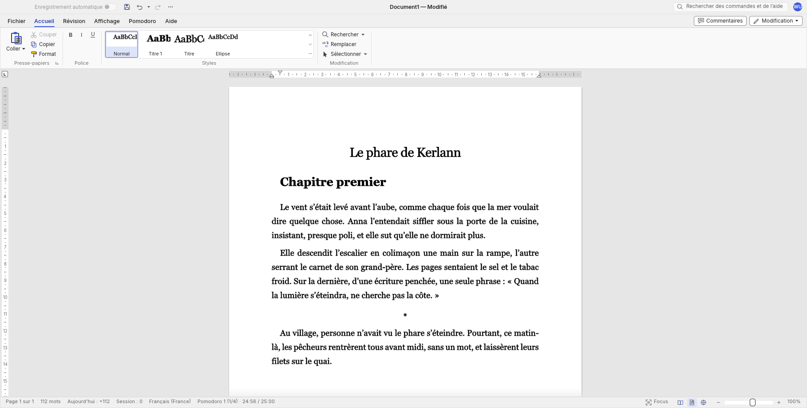

<p align="center">
  
</p>

<h1 align="center">WriteCraft</h1>

<p align="center">
  Un traitement de texte épuré pour écrire, basé sur <a href="https://github.com/storytold/wordcraft">WordCraft</a>.
</p>

<p align="center">
  <a href="https://github.com/ymauray/writecraft/releases/latest"></a>
  
</p>

<p align="center">
  
</p>

WordCraft vise la parité avec Microsoft Word, avec tout ce que ça comporte de menus et d'onglets. WriteCraft en garde le moteur et retire presque tout le reste : il ne reste que ce qui sert à écrire un texte long, un roman ou un essai, sans être distrait par la mise en page. Les fichiers restent des `.docx` ordinaires, qui s'ouvrent partout.

Le ruban se réduit aux onglets Fichier, Accueil, Révision, Affichage et Aide. Un nouveau document est en français, en Georgia 14 points justifié, avec un interligne de 1,5 et quatre styles : Normal, Titre, Titre 1 et Ellipse, pour les séparateurs de scène. Le correcteur orthographique est coupé, faute de dictionnaire français.

Deux ajouts sont propres à WriteCraft. Un onglet Pomodoro, dont le minuteur s'affiche aussi dans la barre d'état et se lance d'un clic, avec des sons au début et à la fin de chaque période. Et deux compteurs à côté du nombre de mots : les mots écrits aujourd'hui, tous documents confondus, et ceux du pomodoro en cours.

## Installer

Les fichiers sont dans les [releases](https://github.com/ymauray/writecraft/releases/latest) : un DMG pour macOS (Apple silicon et Intel), et pour Windows un installateur MSI ou un zip portable. L'installateur Windows installe pour l'utilisateur seul, sans droits d'administrateur.

Les binaires ne sont pas signés. Au premier lancement, macOS demande une confirmation (clic droit sur l'application, puis Ouvrir), et Windows aussi (« Informations complémentaires », puis « Exécuter quand même »).

WriteCraft a son propre nom, sa propre icône et son propre dossier de réglages : il s'installe à côté de WordCraft sans le gêner.

## Construire depuis les sources

Il faut Rust et une copie de [craft-i18n](https://github.com/storytold/craft-i18n), au commit indiqué dans `craft-i18n.rev`, pour les traductions. Sans elle, l'interface reste en anglais.

```sh
CRAFT_I18N_DIR=../craft-i18n cargo run --release -p wordcraft
```

Les scripts de packaging sont dans `packaging/writecraft/`. La CI les lance pour chaque tag `vX.Y.Z` (`.github/workflows/writecraft-release.yml`).

## WriteCraft et WordCraft

WriteCraft est un fork de [WordCraft](https://github.com/storytold/wordcraft), de l'équipe ArtCraft, et suit ses évolutions. Les modifications masquent des parties de l'interface plutôt que de les supprimer, pour que les mises à jour de WordCraft se fusionnent sans conflit. [`WRITECRAFT-OVERVIEW.md`](../WRITECRAFT-OVERVIEW.md) les décrit en détail. Tout le travail sur le moteur, le format `.docx` et la mise en page revient aux contributeurs de WordCraft.

Comme WordCraft, WriteCraft est sous double licence [MIT](../LICENSE-MIT) ou [Apache 2.0](../LICENSE-APACHE), au choix.
